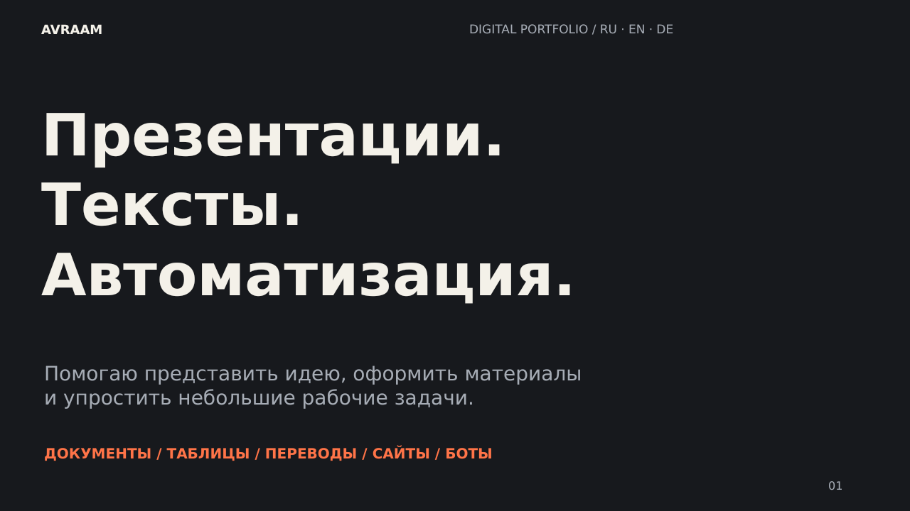

## Помогаю представить идею и упростить рабочую задачу

Презентации и документы, таблицы, переводы RU / EN / DE, небольшие сайты и Telegram-боты, Python с ИИ.

### Что можно поручить

| Направление | Результат |
|---|---|
| Презентации | Структура и оформление, редактируемые слайды и PDF |
| Тексты и документы | Инструкции, деловые материалы, редактура и корректура |
| Excel / Google Sheets | Простой учёт, формулы, фильтры и сводные показатели |
| RU ↔ EN / DE | Общая деловая переписка и несложные тексты |
| Сайты и Telegram | Небольшие прототипы по согласованному заданию |
| Python и ИИ | Обработка CSV, промпты и шаблоны задач |
| Контент и информация | Тексты постов, контент-планы, краткие обзоры открытых источников |

### Работы и исходники

- **[Портфолио](https://github.com/phillipp-preobrayhensky/portfolio)** — примеры, превью и редактируемые файлы.
- **[Catalog CSV Checker](https://github.com/phillipp-preobrayhensky/catalog-csv-checker)** — небольшой Python-инструмент с отчётами и девятью тестами.

### Инструменты

MS Office · Google Workspace · Python · Telegram · Git / GitHub · Supabase

Учусь программированию. Предпочитаю согласовывать задачу в переписке: исходники, результат, объём, срок. Использую ИИ; учебные примеры отмечены, вымышленные клиентские результаты не заявляются. EN / DE — B2–C1 по самооценке.

**EN** · Presentations, documents, spreadsheets, RU/EN/DE business texts and small AI-assisted Python projects. Editable examples and source files are included.
